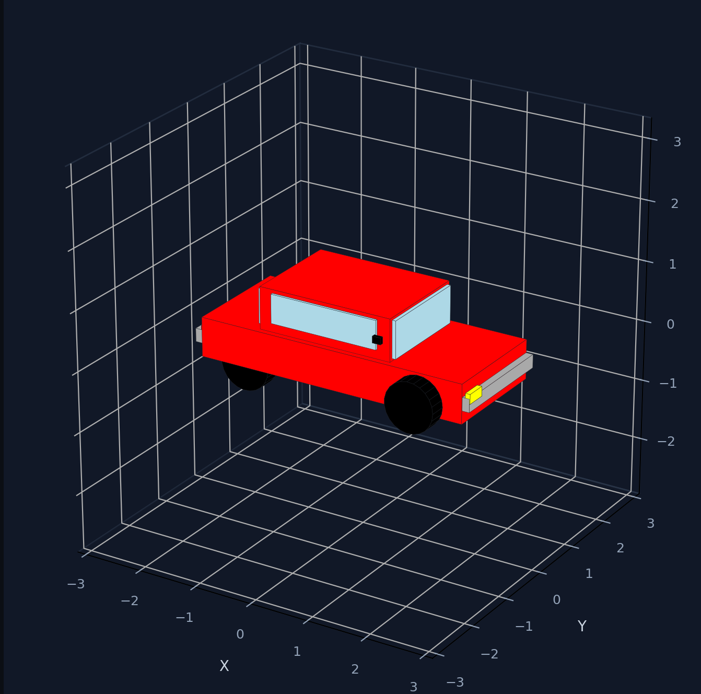
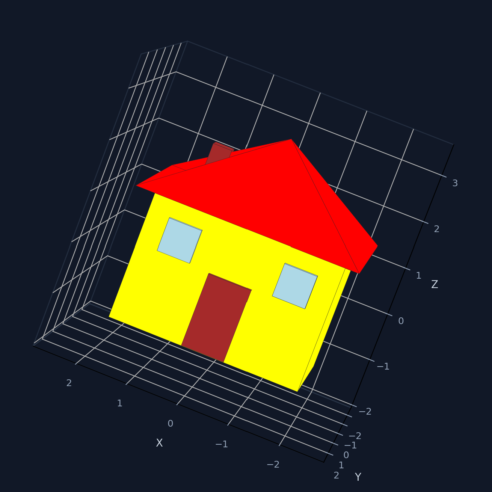
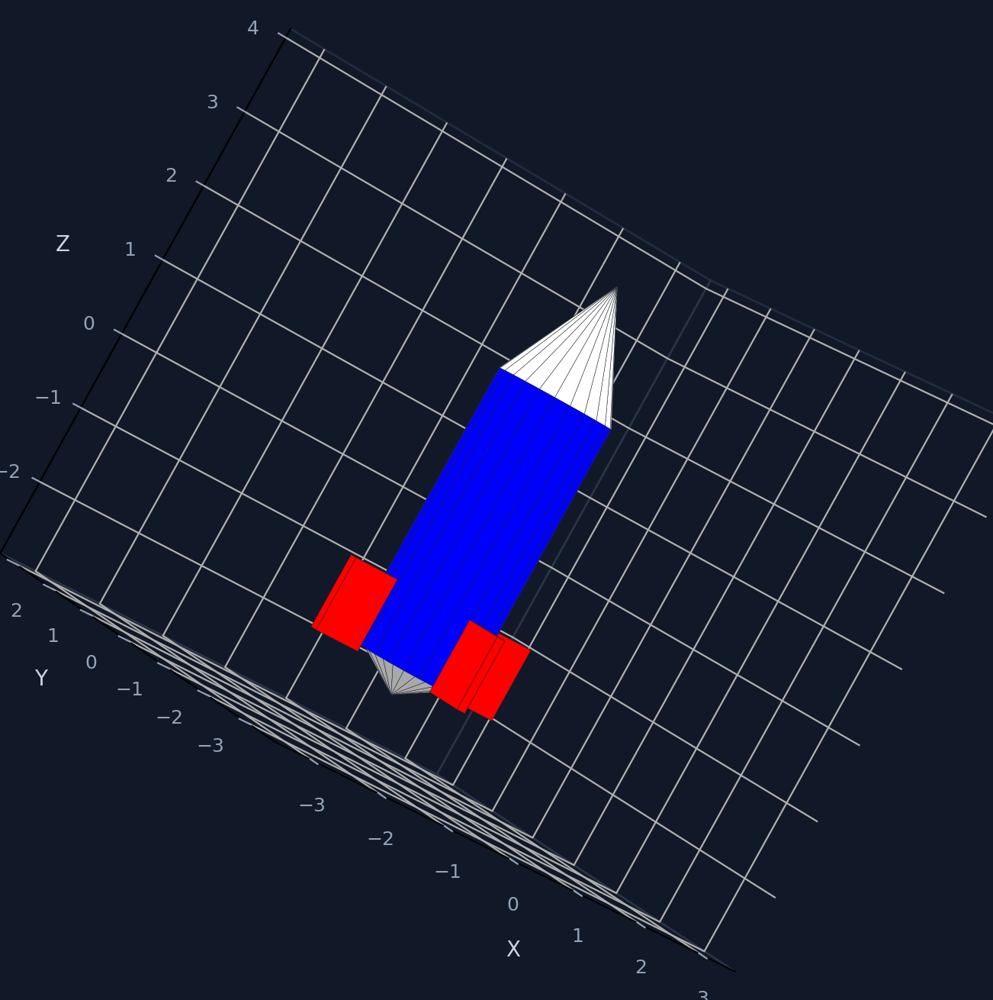
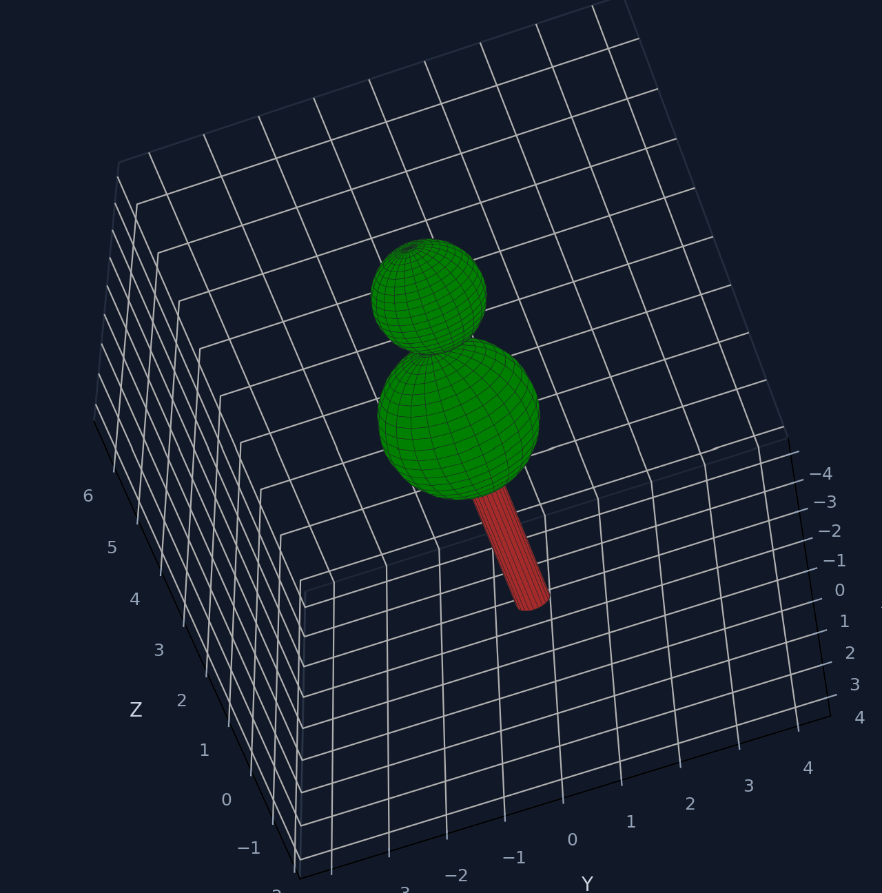
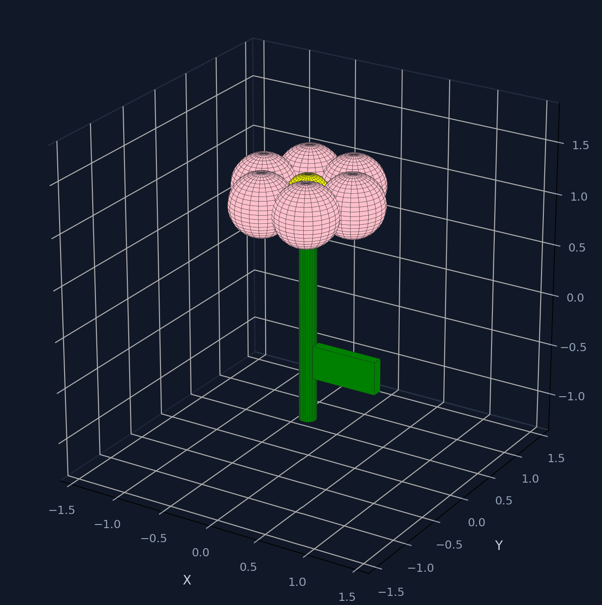
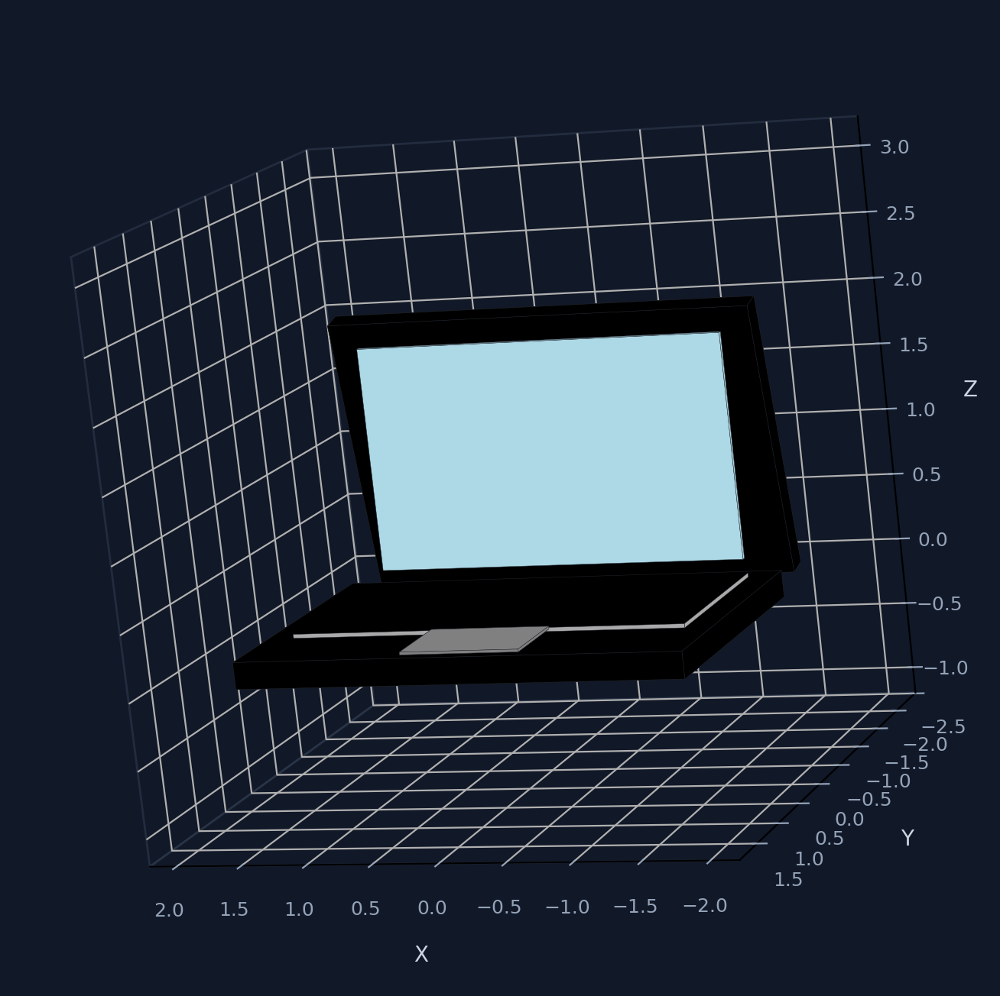

# OTTO — Voice & Vision to 3D CAD

**Won 1st place — Junior College 1 category, a national STEAM Competition, 2026.**

OTTO is a Python project that turns voice commands or camera images into 3D models. You can speak an object into existence, show one to a webcam, spin the result with your hand, and export it for 3D printing.

---

## Demo

Outputs built with OTTO (voice and camera):

|  |  |  |
|:---:|:---:|:---:|
| Sports Car | House | Rocket |
|  |  |  |
| Tree | Flower | Laptop |

---

## What it does

- **Voice to 3D** — Hold `Q`, speak an object name (e.g., "generate a red sports car"), and the program builds a 3D model.
- **Camera to 3D** — Point a webcam at an object, capture a frame, and Gemini rebuilds it as 3D primitives.
- **Hand gestures** — Rotate and zoom the 3D viewer with hand movements (MediaPipe).
- **Export** — Save models as STL or OBJ for 3D printing.

---

## How it works

Two input paths, one shared viewer at the end.

### Voice path

1. `main.py` records your voice while `Q` is held, then transcribes it.
2. A local Ollama model classifies the intent: `GENERATE_3D`, `CAMERA`, or `CHAT`.
3. `GENERATE_3D` → `shapes.py` checks `shape_catalog.py` first. If the object is a known preset (car, house, rocket, etc.), it renders instantly with no API call. Unknown objects go to Gemini.
4. `CAMERA` → launches `camera.py`.

### Camera path

1. `camera.py` picks the sharpest frame from the last few webcam frames.
2. Sends it to Gemini Vision, which returns a part-by-part primitive model (boxes, cylinders, etc.).
3. A geometry audit snaps floating parts back on, drops tiny specks, and validates the layout.
4. The layout is handed to `shapes.py` for rendering.

### Shared viewer

`shapes.py` renders everything with Matplotlib, `skeleton.py` runs hand tracking in a worker thread, and the export bar lets you save as STL or OBJ.

---

## Files

```
otto/
├── main.py              # Voice assistant + intent router
├── camera.py            # Webcam → Gemini → 3D layout
├── shapes.py            # 3D renderer + geometry engine
├── shape_catalog.py     # Local preset models (no API needed)
├── skeleton.py          # Hand tracking with MediaPipe
├── presentation.html    # Competition slide deck
├── image/               # Demo screenshots
└── .gitignore
```

---

## Requirements

- Python 3.9+
- A webcam
- [Ollama](https://ollama.com) installed and running locally
- A Gemini API key

---

## Setup

### 1. Clone and install

```bash
git clone https://github.com/your-username/otto.git
cd otto
pip install -r requirements.txt
```

If you don't have a `requirements.txt`, install the packages directly:

```bash
pip install openai python-dotenv opencv-python numpy matplotlib pillow pyaudio pyttsx3 SpeechRecognition mediapipe
```

### 2. Pull the Ollama model

```bash
ollama pull qwen2.5-coder:3b
```

### 3. Create a `.env` file

Create a `.env` file in the project root:

```env
GEMINI_API_KEY=your_key_here
# Optional fallback keys, tried in order if the first one hits its quota:
# GEMINI_API_KEY_2=
# GEMINI_API_KEY_3=
# Or comma-separated:
# GEMINI_API_KEYS=key1,key2,key3

OLLAMA_MODEL=qwen2.5-coder:3b
OLLAMA_BASE_URL=http://localhost:11434/v1

# Optional
# GEMINI_MODEL=gemini-3.6-flash
# GEMINI_BUILD_MODEL=gemini-3.6-pro
# CAMERA_INDEX=0
```

---

## Usage

### Run the voice assistant

```bash
python main.py
```

Hold `Q` and speak. Examples that work:

- `"Generate a red sports car"`
- `"Make a house"`
- `"Show me a rocket"`
- `"Open the camera"`
- `"What is 12 times 8"` — routes to chat

### Run the camera tool directly

```bash
python camera.py
```

### Run the shape generator on its own

```bash
python shapes.py blue rocket
```

### Viewer controls

| Input | Action |
|---|---|
| Scroll wheel | Zoom in / out |
| Left-click drag | Rotate the model |
| Open hand (webcam) | Zoom in |
| Closed fist (webcam) | Zoom out |
| Index finger only | Swipe to rotate |
| `Q` (hand-tracking window) | Close hand tracking |
| **Save 3D model** button | Export as STL or OBJ |

---

## Known limitations

- **Internet required for Gemini.** Voice-to-3D works offline for catalog presets, but camera-to-3D and unknown objects need a network connection.
- **Camera builds take ~10–30 seconds.** Gemini has to describe the object part by part, and the geometry audit runs afterwards.
- **Hand tracking needs decent lighting.** MediaPipe struggles in low light or against cluttered backgrounds.
- **One hand only.** `skeleton.py` is configured for a single hand.
- **Camera window is fixed at 420×300.** It opens in the top-right corner of your screen.
- **Windows webcam backend.** `cv2.CAP_DSHOW` is used, which is Windows-specific. On Linux/macOS you may need to remove it in `camera.py` and `skeleton.py`.
- **The camera index is hardcoded to 0** in `skeleton.py`. If you have multiple webcams, edit that line.

---

## Troubleshooting

**"Camera could not be opened."**
Change `CAMERA_INDEX` in `.env` (try `1`, `2`, ...) or close any other app using the webcam.

**"All configured Gemini API keys have reached their quota."**
You've hit the free tier limit. Wait for the reset, or add more keys in `.env` as `GEMINI_API_KEY_2` and `GEMINI_API_KEY_3`.

**Voice commands do nothing.**
Check that Ollama is running (`ollama list` in a terminal) and that the model in `.env` is actually pulled.

**Hand tracking doesn't start.**
Install MediaPipe (`pip install mediapipe`). The viewer will still work without it — you just lose gesture control.

**No sound / TTS errors.**
`pyttsx3` needs a system TTS engine. On Linux, install `espeak` or `festival`.

**`ModuleNotFoundError: No module named 'pyaudio'`.**
- Windows: `pip install pipwin && pipwin install pyaudio`
- macOS: `brew install portaudio` first
- Linux: `sudo apt install portaudio19-dev` first

---

## Team

**Maniacal Coding Negus**
STEAM Competition · 2026

---

## License

MIT — see `LICENSE` for details.